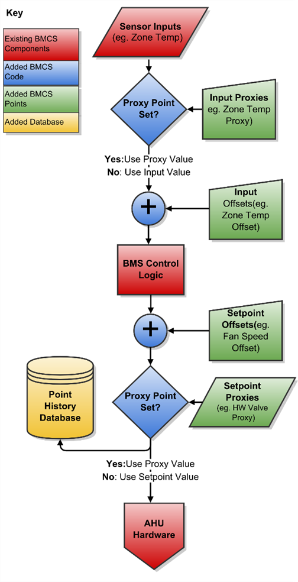
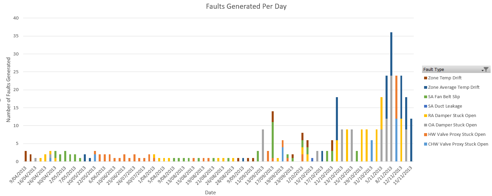
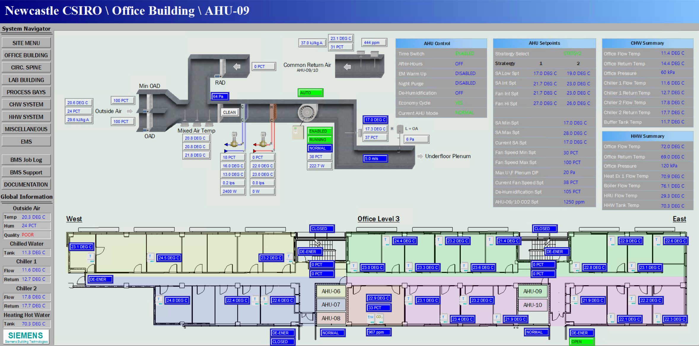
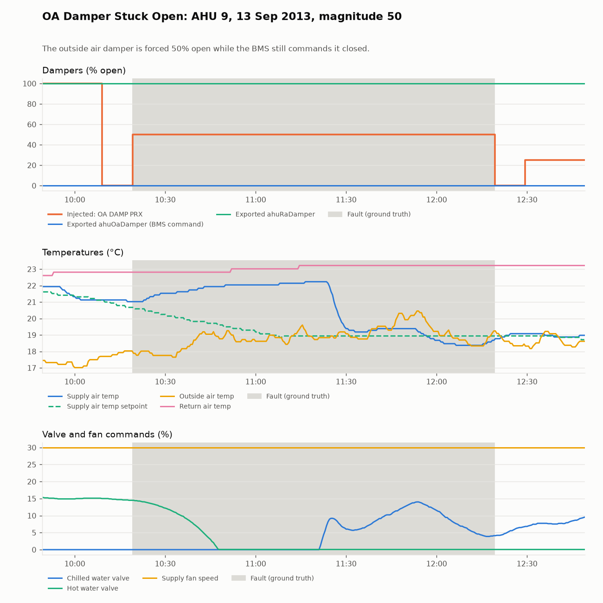
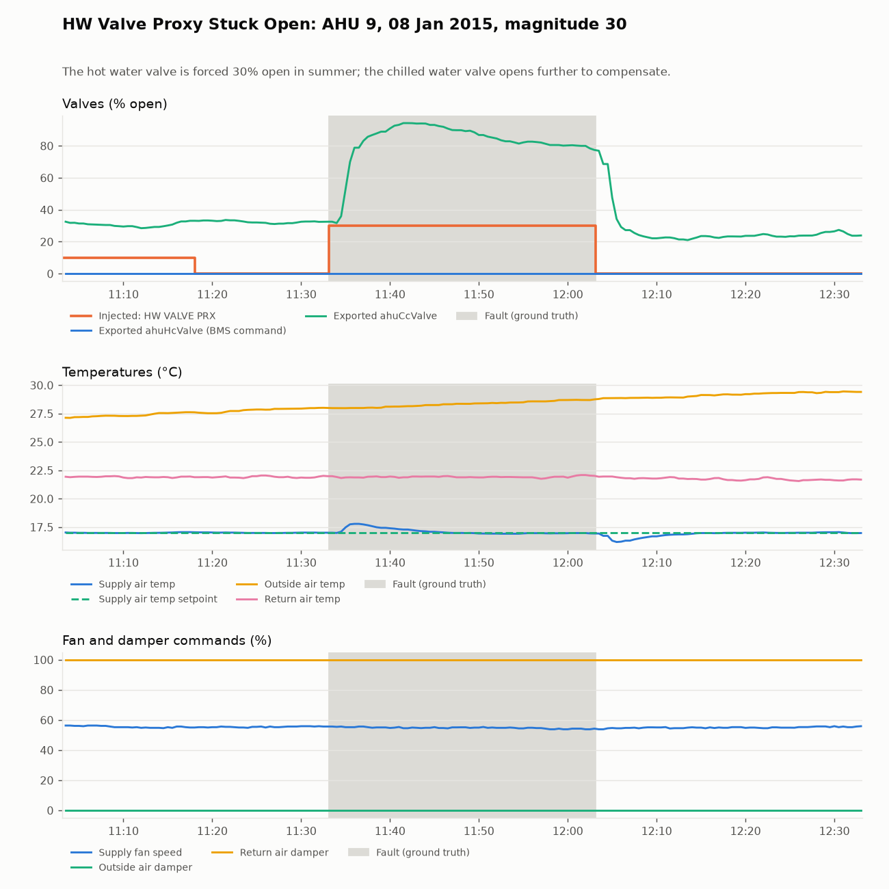
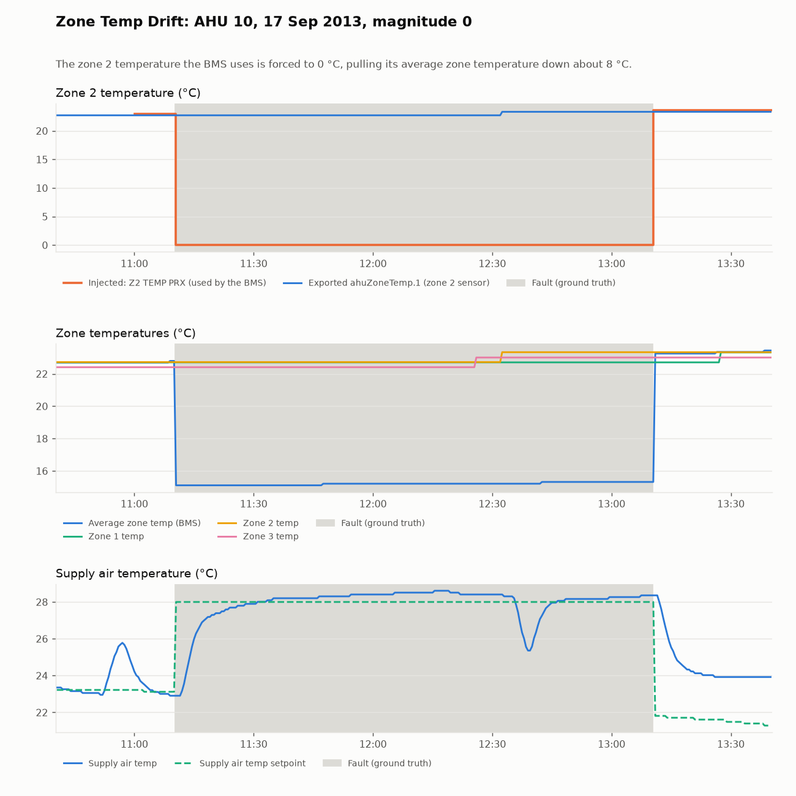
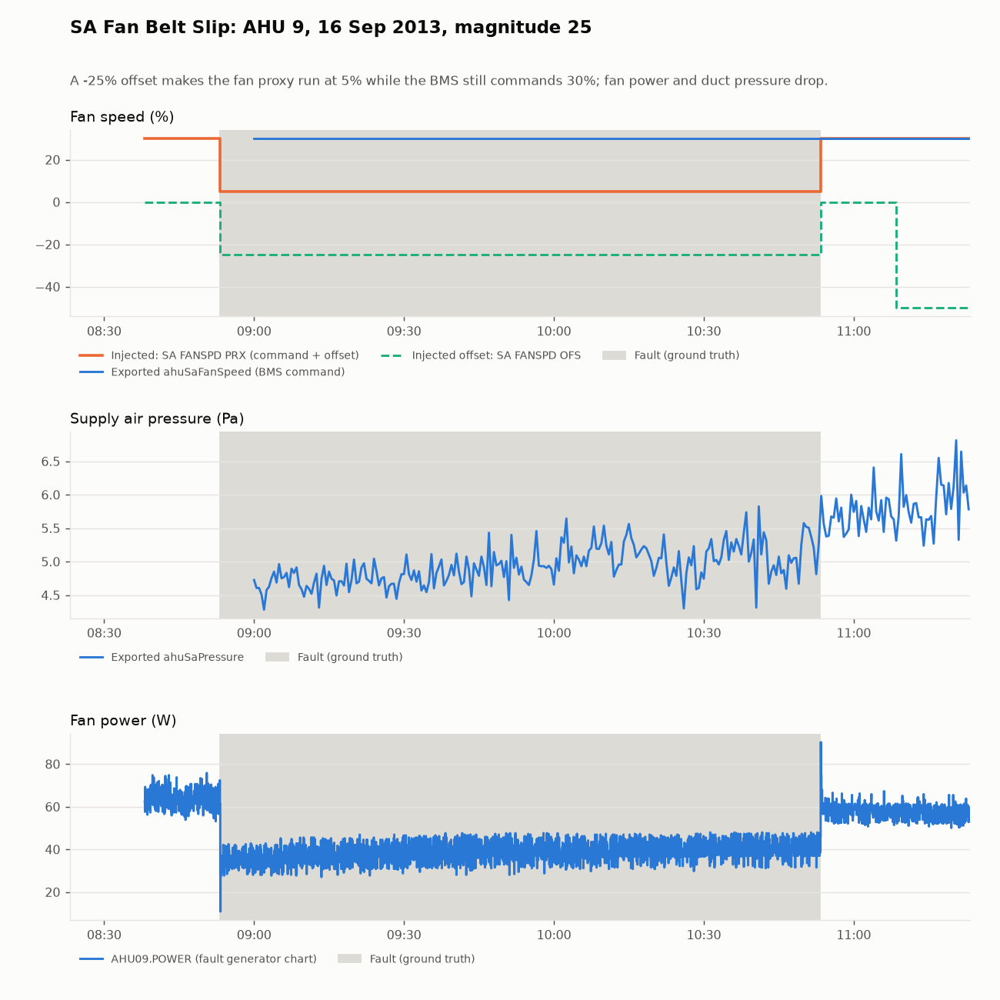

# ahu-fault-detection-dataset

Dataset containing fault-generation experiments on two of CSIRO Energy's Newcastle Office building Air Handling Units (AHU) system. This is intended
to provide a reference dataset for the development and comparison of new fault detection and diagnosis (FDD) algorithms for Heating Ventilation and
Air Conditioning (HVAC) systems.

This dataset was generated by inserting faults into the Building Management System (BMS) of an operational 4-storey office building in Newcastle,
Australia in April-November 2013 and January 2015. This data is made available as-is for use by other researchers, and minimal support or maintenance
will be provided, and only at the authors' discretion.

Fault types generated include:

- Leaking supply-air duct
- Slipping supply-air fan belt
- Stuck/leaking hot water valve
- Stuck/leaking chilled water valve
- Stuck/leaking outside air damper
- Stuck/leaking return air damper
- Average zone air temperature sensor offset
- Single zone air temperature sensor failure

Faults were designed for comparing standardised rule-based Fault Detection and Diagnosis (FDD) rules to more advanced techniques.

These faults were generated by adding 'proxy' points into the BMS code which can override the control signals sent to actuators or received from
sensors, while masking the real values from the BMS's control logic.

The operation of the input/sensor proxy points and the output/setpoint proxies is slightly different

- **Input proxy points** (for the zone temperature sensors) allow us to inject a temperature offset to simulate a sensor drift or miscalibration, and the
  faulty value **should** be visible to the BMS and the fault detector
- **Output proxy points** (for the damper and valve actuators) allow us to control actuator positions to simulate slipping belts or broken actuators
  **without** the BMS or fault detector observing the fault directly. Note that these actuators had no position feedback sensor, so the output proxy
  values _are_ the hardware position.



The actual fault type and magnitude was randomised by custom fault generation software. A summary of the faults generated is below.


AHU 9 & 10 Schematic


## Data files

| File | Contents |
|-------------------------------------------|-----------------------------------------------------------------------------------------------------------------------------------------------------------------------------------------------------------------------------------------|
| `data/AHU9.parquet`, `data/AHU10.parquet` | For testing FDD. BMS time series at 30s intervals, 9am to 5pm only, from May 2013 to May 2015 (no data from April to August 2014). |
| `data/fault-experiments.parquet` | Ground truth: one row per fault experiment. Rows whose `Fault Description` contains `recovered from fault-generator log` come from the fault generation software's log |
| `data/proxy_points.parquet` | Values of the proxy points (`... PRX`) recorded by the fault generation software during its runs (April 2013 to January 2015), with `time_local` matching the AHU data's timestamps. `overridden_point` is the point each run overrode. |
| `data/fault_experiments/` | The fault generation software's chart of each run that overrode a point. |

## How injected faults appear in the data

The BMS logic calculates each valve, damper and fan speed command as normal, then copies it to a proxy point that drives the actuator, unless the
proxy is overridden. Faults were injected by overriding the proxy (e.g. `CS.EC.OFF.AHU 09.OA DAMP PRX`), so the logged command (e.g.
`CS.EC.OFF.AHU 09.OA DAMP`, exported as `AHU9ahuOaDamper`) keeps showing the controller's value, as it would during a real actuator fault. The
injected values are only in `fault-experiments.parquet` and `proxy_points.parquet`. The fan belt slip offset is added in the fan speed proxy, so
`ahuSaFanSpeed` doesn't include it either. The dampers have no position feedback sensors.

Zone temperature faults work the other way round: the controller uses the overridden zone temperature proxies and offset, but the exported
`ahuZoneTemp` columns hold the real sensor readings. `ahuAvgZoneTemp` includes the fault, so the difference between it and the mean of the
`ahuZoneTemp` columns reveals zone temperature faults in a way a real sensor fault wouldn't.

### Example faults

Each figure shows one fault: the injected proxy value (orange) beside the exported BMS points and the system's response. Grey bands are the
ground-truth fault intervals.

**Outside air damper stuck at 50% (AHU 9, 13 September 2013).** The exported damper command stays at 0% while the proxy holds the damper at
50%; the supply air warms and the chilled water valve opens.



**Hot water valve stuck at 30% (AHU 9, 8 January 2015).** The exported hot water valve command stays at 0% in summer while the proxy opens
the valve; the chilled water valve opens from about 33% to 95% to compensate.



**Zone 2 temperature sensor reading 0 °C (AHU 10, 17 September 2013).** The BMS uses the proxy's 0 °C, so its average zone temperature
falls to about 15 °C and it raises the supply air setpoint to 28 °C. The exported zone 2 column holds the sensor's real reading.



**Supply fan belt slip of 25% (AHU 9, 16 September 2013).** The proxy runs the fan at 5% while the exported command stays at 30%. Fan
power, recorded by the fault generation software, drops from about 62 W to 38 W.



## Known issues

- `ahuMaTemp` is a copy of `ahuSaTemp` for both AHUs, so the dataset has no mixed-air temperature.
- Faults are only labelled for April to November 2013 and January 2015. The rest of the data isn't guaranteed to be fault-free.

## Referencing

If you use this dataset in your research or publications, please cite the following paper:

`Guo, Ying; Wall, Josh; Li, Jiaming; West, Sam. Intelligent Model Based Fault Detection and Diagnosis for HVAC System Using Statistical Machine Learning Methods. In: ASHRAE 2013 Winter Conference; January 26 - 30, 2013; Dallas, USA. ASHRAE; 2013. 119-124. http://hdl.handle.net/102.100.100/98252?index=1`

See [here]([http://hdl.handle.net/102.100.100/98252](http://hdl.handle.net/102.100.100/98252?index=1))
or [here](https://www.researchgate.net/publication/262640090_Intelligent_Model_Based_Fault_Detection_and_Diagnosis_for_HVAC_System_Using_Statistical_Machine_Learning_Methods)
for the paper.

## License

See [LICENSE](LICENSE) for code license.

Data is licensed under the [Creative Commons Attribution-ShareAlike 4.0 International Public License](http://creativecommons.org/licenses/by-sa/4.0/).

## Quick start:

If you just want to access the data, do this:

```shell
git clone <this-repo-url>
git lfs install
git lfs pull
```

After that, you should have the data in the `data/` directory.

For an example of how to join the time-series data to the ground truth table, see `join_ground_truth()`
in [data_wrangling.py](src/hvac_fdd_dataset/data_wrangling.py)

## Development

If cloning this to set up the environment for development, run these commands:

```shell
git clone <this-repo.git>
cd  <this-repo-url>

# We recommend using `pyenv` to manage multiple python versions. If pyenv is installed, just run:
pyenv install 3.9.13 # or whatever >=3.9 version you'd prefer
pyenv local 3.9.13 

# ...OR if you don't use pyenv, run:
poetry env use c:\path\to\python3.9\python.exe # Windows  
poetry env use /path/to/python39 # Linux/Mac

# install libraries
poetry install

# install pre-commit hooks for code quality etc
pre-commit install

# run tests locally
pytest

```
